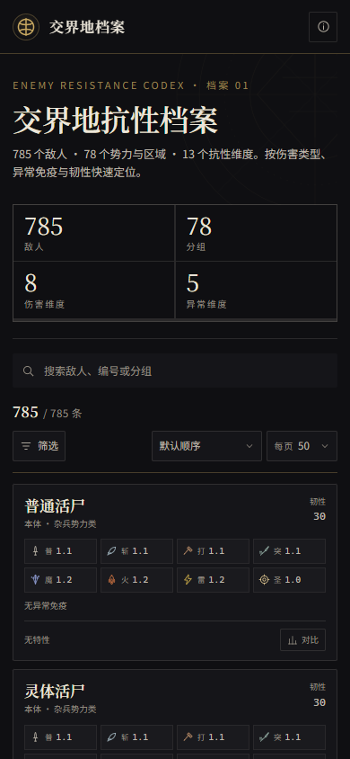

# 交界地抗性档案 · The Lands Between Archive

《艾尔登法环》敌人抗性资料库。把两份人工整理的 JSON 变成可筛选、可对比、可分享的静态数据站。

**在线站点：** [wbx1217.github.io/EldenData](https://wbx1217.github.io/EldenData/)

- **785** 个敌人 · **78** 个分组 · **8** 个伤害维度 · **5** 个异常维度
- 本体 483 条（28 个势力 / 类别分组）+ DLC 302 条（50 个区域分组）
- 纯静态导出，无后端、无数据库、无登录




## 功能

- **高密度数据表**：名称 → 韧性 → 8 项伤害承受 → 5 项异常抵抗 → 特性 → 分组；名称列按当前页最长名称自适应，不显示 ID；特性列窄列居中。
- **筛选**：来源、分组、弱点 / 抗性、异常免疫、特性、韧性区间；所有条件可组合。
- **列联动高亮**：选中伤害倾向或异常免疫后，对应列的表头与单元格显示金色边框高亮。
- **单项排序**：排序下拉按“综合 / 按伤害承受 / 按异常抵抗”分组，8 项伤害与 5 项异常都支持升 / 降序；也可以直接点击表头属性列排序，表头箭头与下拉同步。
- **搜索**：名称、原始编号、分组名；支持 `/` 或 `⌘K` 聚焦，命中高亮。
- **详情抽屉**：自绘 SVG 雷达图、逐项明细、等级判断、数据解读、同组跳转。
- **对比**：最多 3 个敌人，雷达叠加 + 13 行数据对照，自动标出更抗 / 更弱。
- **可分享 URL**：筛选、排序、页码、详情、对比全部写进 query，刷新可还原。
- **分页**：每页 30 / 50 / 100，或“全部显示”（785 条一次展开）。
- **吸顶信息**：向下滚动时，结果计数 / 排序 / 每页 / 已选筛选保持吸顶；“基础 / 伤害承受 / 异常抵抗 / 归档”与名称、韧性等两级表头作为一个整体吸顶，横竖分隔线统一为 1px 金色。
- **响应式**：≥1440 侧栏 + 全表；1160–1439 全宽表 + 筛选面板；≤1159 卡片（641–1159 两列，≤640 单列）。
- **图标系统**：17 枚自绘 SVG（8 伤害 / 5 异常 / 4 特性），16px 可辨，无官方素材。
- **数据说明**：免疫值、0 倍率、缺失值、重复编号等口径在页面内可查。

## 技术栈

- Next.js 15（App Router）+ React 19 + TypeScript strict
- 手写 CSS design tokens，无 UI / 图表 / 动画依赖
- 静态导出：`output: "export"`，构建产物在 `out/`
- 数据在构建期静态 import，客户端筛选，无网络请求

## 快速开始

```bash
pnpm install
pnpm dev
# 打开 http://localhost:3000
```

构建静态站点：

```bash
pnpm typecheck
pnpm build
# out/ 可直接部署到任意静态托管
```

## 数据管线

原始文件放在本地项目根目录（已加入 `.gitignore`，不提交到 GitHub）：

- `本体敌人数据.json`
- `DLC敌人数据.json`

部署和构建只依赖已经归一化的 `src/data/enemies.json`；克隆仓库后如需重新清洗，需自行放入这两份原始文件，然后运行：

```bash
pnpm normalize
```

脚本会：

1. 识别 `名称` 与数值字段全空的分组标题（不是敌人）。
2. 统一本体 / DLC 两套字段名（`基础毒抵抗力` 与 `毒抵抗力`）。
3. 把 `999` 与字符串 `"免疫"` 归一为 `status.* = "immune"`。
4. 生成唯一 `key`（原始 id 有 21 处复用，不能直接当 React key）。
5. 输出 `src/data/enemies.json` 与本地报告 `reports/data-quality.md`（报告不提交）。
6. 断言数量：本体 511 条 / 28 组 / 483 敌人，DLC 352 条 / 50 组 / 302 敌人，合计 785 / 78。

### 数据口径

- **伤害倍率**：受到该属性伤害的倍率。`1.0` 基准，`<1` 抗性，`>1` 更易受伤，`0` 完全免疫；范围 0–2。表格底色按 0.1 一档加深：绿色越深表示承受越高、越易受伤，红褐色越深表示承受越低、越抗。
- **异常抵抗**：数值越高越抗；`999` 与 `"免疫"` 都显示为“免疫”，页面不出现 999。
- **韧性**：30–300；原始 `-1` 与空值显示为“—”，不参与韧性筛选。
- **缺失值**：26 条记录存在缺失字段，详情标记“数据不完整”；雷达图缺失轴按 1.0 补位并提示。
- **同名 / 同 id**：同名跨区域重复是正常的；同 id 复用 21 处，内部用 `key` 区分，详情链接不会串行。
- **分组语义**：本体分组是势力 / 类别，DLC 分组是区域；页面按来源显示不同标签。

## 目录

```text
src/
  app/
    layout.tsx          元数据与全局样式
    page.tsx            静态入口，注入 enemies.json
    globals.css         设计 tokens、布局、表格、抽屉、响应式
    icon.svg            favicon
  components/
    ArchiveApp.tsx      状态、筛选、表格、卡片、分页、URL
    DetailDrawer.tsx    详情抽屉与数据解读
    CompareDialog.tsx   3 人对比
    FilterSheet.tsx     移动端 / 窄屏筛选面板
    InfoDialog.tsx      数据说明
    RadarChart.tsx      手写 SVG 雷达图（单人与多人共用）
    icons.tsx           17 枚自绘图标 + UI 图标
  lib/
    types.ts            数据类型
    labels.ts           中文标签、颜色、排序项
    derive.ts           平均承受、最弱属性、等级、格式化
    filters.ts          URL query 读写
    useDialog.ts        焦点陷阱、Esc、滚动锁
  data/enemies.json     785 条归一化数据
scripts/normalize.mjs   数据清洗与校验
src-tauri/
  tauri.conf.json       Tauri 窗口 / 打包配置
  Cargo.toml            Rust 依赖
  src/                  桌面入口与 Tauri Builder
  icons/                Windows 图标
  capabilities/         桌面权限
```

## 设计

- 深墨底 `#0F0F12` + 纸色文字 `#ECE6D9` + 古金 `#C9A961`；金色只用于结构线、交互态与强调。
- 标题使用本机 `Noto Serif SC` / 宋体回退；正文 `Noto Sans SC` / 苹方 / 雅黑；编号使用等宽字体。
- 表格是主角：两级表头、粘性名称列、数字等宽、绿色易伤 / 红褐抗性底色、免疫斜线底纹；名称列按当前页最长名称测量宽度。
- 特性列使用中文标签而不是图标，固定窄列居中；分组列固定在表格最右侧。
- 筛选联动：选中的伤害 / 免疫列会加金色边框与浅金底，表头同步高亮。
- 分组树默认折叠，避免 78 个分组一次铺满侧栏。
- 无大图、无玻璃拟态、无渐变紫；纹理只保留极淡径向光。
- 动效仅用于抽屉、对比层、筛选面板；支持 `prefers-reduced-motion`。

## 验收结果

- `pnpm build` 通过，TypeScript 无错误，静态导出成功。
- 标题统计 785 / 78 / 8 / 5，全部来自 `meta`。
- 列表不出现分组标题；`999` 在页面文本中为 0 次。
- 搜索“幽影人”得到 17 条，跨多个 DLC 区域，命中高亮。
- 来源 + 分组 + 异常免疫组合筛选可用；URL 刷新还原搜索与筛选。
- 伤害 / 免疫筛选后，对应列的表头与单元格出现金色高亮边框；取消筛选即恢复。
- 排序下拉包含 8 项伤害 × 2 个方向、5 项异常 × 2 个方向；点击表头“火”可在降序 / 升序间切换，URL 同步为 `sort=fireDesc` / `sort=fireAsc`。
- 搜索“骑士”后按火焰降序 / 升序排序，首行从 1.2 / 0.6 正确切换；旧链接 `sort=name` 自动兼容为 `nameAsc`。
- 分组树默认折叠；展开 / 收起箭头方向正确。
- “全部显示”可选，785 行一次展开；分页信息与 URL `size=all` 正常。
- 1440 / 1366 / 1280 / 1160 下向下滚动，结果栏与两级表头吸顶；两级表头之间无缝隙、分隔线保留。
- 表头横 / 竖分隔线统一为 1px 金色内阴影；名称 / 韧性行底部只有一条线，DPR 1.25 / 1.5（125% / 150% 缩放）下滚动时不会透出数据底色。
- 表头“名称 / 韧性 / 特性 / 分组”与分组标题均可见；增加筛选标签后表头随结果栏高度自动下移。
- 1024 / 900 / 768 切换为两列卡片，390 / 360 为单列卡片；页面无横向溢出，吸顶工具栏保持可见。
- 移动端 50 张卡片 / 页，筛选面板内置搜索；详情抽屉全屏。
- 键盘：`/` 聚焦搜索、`Esc` 关闭弹层、Tab 焦点陷阱、行 Enter 打开详情。
- 浏览器控制台无报错。

## 部署到 GitHub Pages

仓库已包含 [`.github/workflows/deploy.yml`](.github/workflows/deploy.yml) 和 `public/.nojekyll`。

1. 新建 GitHub 仓库并推送到 `main` 分支。
2. 仓库 **Settings → Pages → Build and deployment → Source** 选择 **GitHub Actions**。
3. 推送后 Actions 会自动构建并发布；地址通常是：
   - 项目站：`https://<用户名>.github.io/<仓库名>/`
   - 用户站（仓库名为 `<用户名>.github.io`）：`https://<用户名>.github.io/`
4. 后续每次推送 `main` 都会自动部署。

`next.config.mjs` 会在 GitHub Actions 中自动推断项目站的 `basePath`；用户站自动使用根路径。自定义域名需要在 workflow 的 `pnpm build` 步骤显式设置 `NEXT_PUBLIC_BASE_PATH: ""` 后重新构建。

**关于访问权限：**

- 仓库是 **Public** 时，开启 Pages 后任何人拿到链接都能直接打开，无需 GitHub 登录；公网可访问，也可能被搜索引擎收录。
- 仓库是 **Private** 时，GitHub Free 不支持 Pages；需要 Pro / Team / Enterprise 才能从私有仓库发布。发布出来的 Pages 站点默认仍是公开站点（企业版访问控制除外）。
- 如果希望“源码私有、站点公开”，可以继续用 GitHub 托管源码，但把 `out/` 部署到 Cloudflare Pages / Netlify / Vercel 的免费静态托管。
- Pages 站点有 1GB 容量和每月流量限制，本项目远低于限制。

本地构建：

```bash
pnpm install
pnpm build
# out/ 即完整静态站点
```

## Windows 桌面版（Tauri 2）

项目包含 Tauri 2 桌面壳，直接加载 Next 静态导出的 `out/`，数据完全离线。

前置环境：

- Rust stable（MSVC toolchain）
- Visual Studio C++ Build Tools
- WebView2 Runtime（Windows 10/11 一般已自带）

开发模式：

```bash
pnpm tauri dev
```

构建 NSIS 安装包：

```bash
pnpm tauri build
```

产物：

```text
src-tauri/target/release/bundle/nsis/*-setup.exe
```

构建完成后可以把安装包复制为 ASCII 文件名再分发，例如：

```text
dist/EldenArchive_1.0.0_x64-setup.exe
```

> NSIS 安装包请放在纯英文路径下运行（例如 `C:\Users\<用户名>\Downloads`）。  
> 如果安装包所在的父目录包含中文，部分 NSIS 版本会报 `Error writing temporary file`；把安装包复制到 Downloads 或 `C:\Temp` 后运行即可。

如果 NSIS 组件下载超时，可以设置 GitHub 镜像后重新构建：

```powershell
$env:TAURI_BUNDLER_TOOLS_GITHUB_MIRROR="https://gh-proxy.com/https://github.com"
pnpm tauri build
```

说明：

- 桌面版使用根路径构建，不会带 GitHub Pages 的 `/EldenData` 前缀。
- 安装包默认按当前用户安装，不需要管理员权限。
- 未签名 exe 首次运行可能触发 Windows SmartScreen；公开分发建议配置代码签名。
- `src-tauri/target/` 已在 `.gitignore` 中排除，不会提交构建产物。

## 声明

非官方粉丝项目。数据来自本地整理的两份 JSON；不包含游戏内图像、官方 Logo、字体或音频。  
《艾尔登法环》及相关名称版权归 FromSoftware / Bandai Namco 所有。
